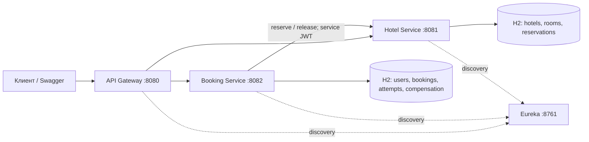

# Hotel Booking API

Учебная система бронирования отелей на Java 21, Spring Boot 3.5.16 и Spring Cloud 2025.0.3. Четыре приложения запускаются отдельными процессами. Gateway, Booking и Hotel проверяют JWT самостоятельно. Eureka защищена HTTP Basic. Booking и Hotel используют отдельные базы H2 в памяти, JPA и Flyway.

## Быстрый запуск в Windows

Нужны JDK 21 и интернет для первой загрузки Maven и зависимостей. PowerShell-сценарии используют встроенный в Windows 10/11 `curl.exe`. Maven, Docker, PostgreSQL и отдельный сервер приложений устанавливать не требуется.

Откройте PowerShell в папке проекта:

```powershell
java -version
javac -version
java scripts/GenerateKeys.java
.\mvnw.cmd -B -ntp verify
.\scripts\start.ps1 -SkipBuild
.\scripts\demo.ps1
```

Если PowerShell блокирует локальные сценарии, запустите конкретный сценарий командой `powershell -ExecutionPolicy Bypass -File .\scripts\start.ps1 -SkipBuild`. Постоянно менять политику системы не требуется. Сценарии предполагают стандартный Maven Wrapper; `start.ps1` без `-SkipBuild` сначала выполняет полную проверку.

Остановка:

```powershell
.\scripts\stop.ps1
```

Сценарий остановки использует только записанные им PID и проверяет время старта процессов. Логи находятся в `.run/`. Все приложения слушают loopback; стандартные порты должны быть свободны.

| Приложение | Адрес |
|---|---|
| [API Gateway](api-gateway/README.md) | http://localhost:8080 |
| [Hotel Service](hotel-service/README.md), Swagger UI | http://localhost:8081/swagger-ui.html |
| [Booking Service](booking-service/README.md), Swagger UI | http://localhost:8082/swagger-ui.html |
| [Eureka](discovery-server/README.md) | http://localhost:8761 |

В Eureka используются логин `registry` и демонстрационный пароль `local-registry-password`. Для замены задайте `EUREKA_PASSWORD` серверу и согласованный `EUREKA_URL` всем клиентам. Эти значения предназначены для локального учебного запуска.

`start.ps1` дожидается запуска приложений и готовности маршрутов Gateway. `demo.ps1` входит, получает рекомендации, создаёт бронь, проверяет повтор запроса, отменяет бронь и ждёт освобождения номера.

## Демонстрационные данные

Профиль `demo` создаёт две гостиницы, шесть рабочих номеров и один номер на ремонте. Также создаются согласованные записи истории в обеих БД: три завершённых проживания, одна будущая бронь и одна отменённая бронь. Поэтому рекомендации и статистику можно проверить сразу.

| Пользователь | Пароль | Роль |
|---|---|---|
| admin | Admin-demo-123 | ADMIN |
| alice | Alice-demo-123 | USER |
| bob | Bob-demo-123 | USER |

Базовая дата — `DEMO_BASE_DATE` в формате `yyyy-MM-dd`, по умолчанию текущая дата UTC. `start.ps1` устанавливает одинаковую дату всем приложениям. Без профиля `demo` базы пустые; для первого администратора используйте демонстрационный профиль.

**H2 работает в памяти:** остановка приложения уничтожает его данные. После остановки одного бизнес-сервиса для согласованного демо перезапустите весь комплект. Восстановление саг после потери процесса требует постоянного хранилища и выходит за ограничение задания.

## Архитектура



Модуль `common` содержит DTO протокола, формат ошибок и средства безопасности. Сущности JPA остаются в своих сервисах. Контроллеры проверяют входные данные и права, сервисы выполняют бизнес-операции, репозитории работают с БД. MapStruct преобразует сущности в DTO, Lombok сокращает шаблонный код сущностей. `HotelOperations` отделяет сагу от HTTP-адаптера. [Модуль common](common/README.md)

## API

Все перечисленные публичные операции доступны через Gateway. Спецификации доступны по `/docs/booking` и `/docs/hotel` через Gateway либо по `/v3/api-docs` соответствующего сервиса.

Чтобы вручную проверить бронирование, откройте Booking Swagger UI из таблицы выше:

1. В `POST /user/auth` нажмите **Try it out** и отправьте `{"username":"alice","password":"Alice-demo-123"}`. Ответ содержит `token`, `tokenType` и `expiresIn=3600`.
2. Нажмите **Authorize** и вставьте значение `token`. В `POST /booking` заполните `X-Request-Id` новым UUID, например из команды `[guid]::NewGuid().ToString()` в PowerShell. Отправьте пример JSON ниже с будущими датами.
3. Убедитесь, что статус брони `CONFIRMED`. Повторите запрос с тем же UUID и телом, чтобы получить ту же бронь. Затем проверьте её через `GET /booking/{id}` и отмените через `DELETE /booking/{id}`.

| Метод и путь | Назначение | Доступ |
|---|---|---|
| POST `/user/register` | Регистрация; `username`, `password` | Публичный |
| POST `/user/auth` | Вход; `username`, `password` | Публичный |
| POST `/user` | Создание; `username`, `password`, `role` | ADMIN |
| GET `/user`, GET `/user/{id}` | Список и чтение пользователя | ADMIN |
| PATCH `/user` | Обновление; `id`, `username`, `password`, `role` | ADMIN |
| DELETE `/user?id=...` | Удаление без истории бронирований | ADMIN |
| POST `/booking` | Создание с `X-Request-Id` | USER |
| GET `/bookings` | Только собственная история | USER |
| GET `/booking/recommend` | Рекомендации через Booking Service: `hotelId`, даты, пагинация | USER |
| GET `/booking/{id}` | Только собственная бронь | USER |
| DELETE `/booking/{id}` | Отмена собственной брони и постановка компенсации | USER |
| GET `/api/hotels`, GET `/api/hotels/{id}` | Чтение гостиниц | USER |
| POST `/api/hotels`, PATCH `/api/hotels/{id}` | `name`, `address` | ADMIN |
| DELETE `/api/hotels/{id}` | Удаление гостиницы без номеров | ADMIN |
| GET `/api/rooms` | Свободные номера на даты | USER |
| GET `/api/rooms/recommend` | Свободные номера по `timesBooked`, затем `id` | USER |
| GET `/api/rooms/{id}` | Данные номера | USER |
| POST `/api/rooms`, PATCH `/api/rooms/{id}` | `hotelId`, `number`, `available` | ADMIN |
| DELETE `/api/rooms/{id}` | Удаление номера без истории резервирований | ADMIN |
| GET `/api/hotels/{id}/statistics` | Статистика гостиницы за период | ADMIN |
| GET `/api/rooms/{id}/statistics` | Статистика номера за период | ADMIN |

ADMIN также получает возможности USER, но не доступ к чужим бронированиям. PATCH в этом учебном API требует все редактируемые поля. Для изменения дат бронирования отмените его и создайте новое.

Для списков: `page=0`, `size=20`, максимум `size=100`. История сортируется по времени создания и id по убыванию. Отели фильтруются по `name`, `address`, сортируются по `sort=id|name`. Для свободных номеров обязательны `startDate`, `endDate`, необязателен `hotelId`. Обычный список сортируется по id; рекомендации — по частоте бронирования. Для статистики обязательны `startDate`, `endDate`.

Gateway поддерживает алиасы `POST /api/bookings`, `GET /api/bookings`, `GET/DELETE /api/bookings/{id}`, `GET /api/bookings/recommend`. Прямые маршруты ТЗ сохранены.

Пример запроса брони:

```json
{
  "autoSelect": true,
  "hotelId": 1,
  "startDate": "2027-01-10",
  "endDate": "2027-01-12"
}
```

Заголовки: `Authorization: Bearer <token>`, `Content-Type: application/json`, `X-Request-Id: <UUID>`. Для ручного выбора передайте `autoSelect=false` и положительный `roomId`. Booking проверяет номер через Hotel и сохраняет фактический `hotelId`; если дополнительно указан другой отель, возвращает 400. При автоматическом выборе `roomId` игнорируется, `hotelId` обязателен. Замените даты на будущие.

Первое успешное создание возвращает `201`, повтор завершённого запроса — `200`, повтор во время обработки — `202`. Один ключ с другим значимым телом возвращает `409`. Повтор ошибочного запроса воспроизводит сохранённый код ошибки и `bookingId`; для новой попытки нужен новый ключ. Отмена возвращает `200` и `CANCELLED`, освобождение выполняется фоново.

## Согласованность и конкурентный доступ

Бронь сначала фиксируется как PENDING. HTTP-вызов выполняется вне транзакции Booking. Hotel блокирует строку номера в БД, проверяет рабочее состояние и пересечение дат, записывает результат операции и изменяет счётчик в одной локальной транзакции. Успех переводит бронь в CONFIRMED, ошибка — в CANCELLED с атомарно созданными задачами компенсации для попыток резервирования.

Периоды полуоткрытые: `[startDate, endDate)`. Условие пересечения: `existing.start < requested.end AND existing.end > requested.start`. Соседние периоды разрешены. Поле `available` обозначает ремонт/эксплуатационную доступность, а не занятость по датам.

`times_booked` — число успешных неотменённых резервирований, включая прошлые проживания. Повторы не изменяют счётчик. Компенсация уменьшает его один раз. Загрузка за период считается отдельно: пересечение активных резервирований с периодом / число календарных номеро-ночей всех номеров. История ремонтов не моделируется; процент отражает календарную вместимость, а не историческую эксплуатационную доступность.

Автоподбор обновляет рекомендации при конфликте и пробует до трёх разных номеров. В одном экземпляре Booking автоматические выборы для одного отеля координируются справедливой очередью: параллельные запросы не используют одновременно один устаревший снимок счётчиков. Очередь ограничена общим временем запроса; блокировки БД Hotel по-прежнему защищают занятость от всех запросов, включая ручные. После тайм-аута выбор другого номера не выполняется: первый уже мог зарезервироваться. При конкуренции с ручными бронированиями возможен `409` после трёх кандидатов даже при наличии других свободных номеров.

Даже при потерянном ответе Hotel сохраняется задача release. Освобождение неизвестной операции оставляет отменённую запись, поэтому поздний confirm не создаст «утёкший» резерв. Задачи остаются в БД до успешного выполнения. После 30 секунд зависшие PENDING отменяются; поздний обработчик не может восстановить CANCELLED.

Отсутствующий отель/номер возвращает 404, без сетевых повторов. Если номер удалён между чтением и резервированием, компенсация release с ответом 404 считается завершённой: Hotel запрещает удаление номера с любой историей резервирования, поэтому удалённый номер не может удерживать слот.

HTTP: соединение 500 мс, ответ не более 1500 мс и оставшегося времени запроса; три попытки с паузами 200/400 мс; общий бюджет саги 20 секунд включает очередь автоподбора. Ответ после истечения бюджета не подтверждает бронь. Повторы только для сетевых ошибок и 5xx. CircuitBreaker открывается при 50% ошибок в окне 10 вызовов, минимум 5, на 5 секунд. Компенсации проверяются раз в секунду; после неудачи интервал растёт до 30 секунд. Hotel может продолжать уже принятый запрос после клиентского тайм-аута, поэтому release и отметка отмены остаются обязательными.

## Безопасность и наблюдаемость

Пользовательские JWT: RS256, issuer `hotel-booking`, audience `hotel-api`, срок один час. Внутренние JWT: audience `hotel-internal`, scope `room:reserve`, срок 60 секунд. Приватный ключ читает только Booking; Hotel и Gateway используют публичный. Настройка путей: `JWT_PRIVATE_KEY`, `JWT_PUBLIC_KEY`; по умолчанию `config/keys/*.pem`. Ключи генерируются локально, исключены из Git. Генератор не заменяет существующую пару.

Внутренние `POST /api/rooms/{id}/confirm-availability` и `POST /api/rooms/{id}/release` принимают `operationId`, `bookingId`, `startDate`, `endDate`. Они доступны только с сервисным JWT, заблокированы Gateway и требуют неизменных параметров при повторе. Самостоятельная регистрация не принимает поле роли. Пароли BCrypt, не длиннее 72 байт UTF-8.

Единый ErrorDTO содержит `timestamp`, `status`, `code`, `message`, `path`, `traceId`, `fieldErrors`, `bookingId`. Статусы: 400/401/403/404/409/503/504. Чужая бронь возвращает 404. Логи ECS JSON сохраняют traceId и ключевые события; пароли и JWT не логируются. `X-Correlation-Id` передаётся через Gateway и HTTP-клиент. Идемпотентность использует отдельный `X-Request-Id`.

Проверки: `/actuator/health`, `/actuator/health/readiness`. Метрики с авторизацией: `/actuator/metrics`, в том числе `hotel.remote.errors`, `hotel.remote.retries`, `hotel.circuit.state`, `booking.compensations.pending`, `booking.compensations.completed`. Gateway не публикует actuator бизнес-сервисов; проверяйте его на их локальных портах.

## Проверка и работа с кодом

```powershell
java scripts/GenerateKeys.java
.\mvnw.cmd verify
.\mvnw.cmd spotless:apply
```

`verify` запускает проверки формата Google Java Format, тесты JWT, интеграционные тесты Hotel/Booking и системные тесты с четырьмя реальными JVM. Системные тесты выбирают свободные порты, завершают процессы и сохраняют логи в `system-tests/target/`. Прокси в тестах позволяет потерять ответ после реального commit Hotel и проверить компенсацию. [Модуль system-tests](system-tests/README.md)

Для проверки бизнес-модулей без системного запуска: `mvnw.cmd -pl hotel-service,booking-service -am test`. Для сборки JAR без тестов: `mvnw.cmd -DskipTests package`. Отчёты: `*/target/surefire-reports`, `system-tests/target/failsafe-reports`. GitHub Actions выполняет `verify` на Java 21 и прикладывает отчёты; фактический статус появится после публикации репозитория.

Подробности: [поэтапный разбор](docs/WALKTHROUGH.md), [схема данных](docs/DATABASE.md), [архитектурные решения](docs/ADR.md), [соответствие критериям](docs/CRITERIA.md), [повторное ревью и результаты запуска](docs/REVIEW.md).

На Linux/macOS выполните `java scripts/GenerateKeys.java` и `sh ./mvnw -B -ntp verify` из корня проекта. После сборки запустите четыре JAR в отдельных терминалах в порядке Eureka → Hotel → Booking → Gateway. Команда для каждого модуля имеет вид `java -jar <module>/target/<module>-1.0.0.jar --spring.profiles.active=demo`. Все команды выполняются из корня проекта.
