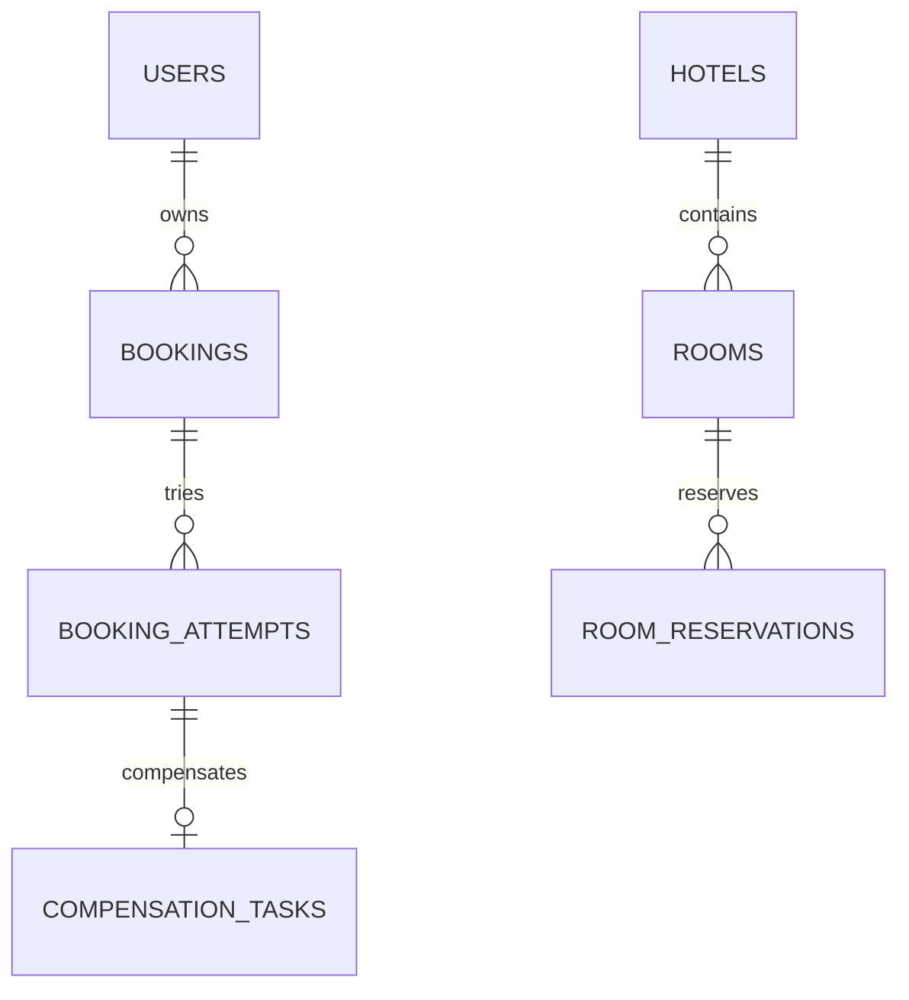

# Схема данных

Миграции находятся в `hotel-service/src/main/resources/db/migration` и `booking-service/src/main/resources/db/migration`. Hibernate работает в режиме `validate`, не создаёт схему. Все связи локальные; идентификаторы другого сервиса хранятся как значения без внешнего ключа в чужую БД.

| БД / таблица | Поля и назначение |
|---|---|
| Booking / users | id, username UNIQUE, BCrypt password, role USER/ADMIN, version |
| Booking / bookings | id, user_id FK, room_id, hotel_id, auto_select, start_date, end_date, status, created_at, request_id, request_hash, trace_id, error_status, error_code, version |
| Booking / booking_attempts | id UUID операции, booking_id FK, room_id, start_date, end_date |
| Booking / compensation_tasks | id FK на попытку, booking_id FK, state READY/DONE, attempts, next_attempt_at, last_error, version |
| Hotel / hotels | id, name, address, version |
| Hotel / rooms | id, hotel_id FK, number, available, times_booked >= 0, version |
| Hotel / room_reservations | id UUID операции, booking_id, room_id FK, start_date, end_date, state ACTIVE/RELEASED/REJECTED |

Уникальные ключи: `(user_id, request_id)`, `(booking_id, room_id)` для попыток, `(hotel_id, number)`. Ограничения дат требуют `end_date > start_date`. CONFIRMED требует непустой room_id; у PENDING при автоподборе room_id может отсутствовать.

Индексы: история пользователя `(user_id, created_at, id)`, recovery `(status, created_at)`, компенсации `(state, next_attempt_at)`, рекомендации `(hotel_id, available, times_booked, id)`, занятость `(room_id, state, start_date, end_date)`.

BOOKINGS и ROOM_RESERVATIONS находятся в разных БД. Их логическая связь проходит по bookingId и UUID операции, а согласованность обеспечивается сагой. RELEASED и REJECTED сохраняются для идемпотентности. Удаление номера с такой историей запрещено. Автоматической очистки журнала в учебном проекте нет.
